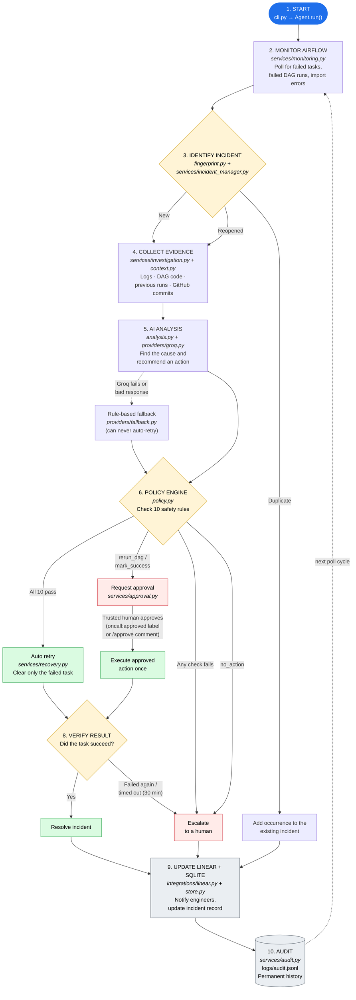

# Architecture Flow: Airflow Oncall Agent

This page shows what the agent does when an Airflow task fails. Read it from top to
bottom and follow the arrows. Each box names the file that does that step.

For design decisions and the package layout, see [architecture.md](architecture.md).

---

## Big picture



**Colour key:** blue = start · yellow = decision · green = automatic fix · red = needs a
human · grey = records.

---

## Plain-text version

Use this version when Mermaid doesn't render, for example in a terminal.

```
                  ┌──────────────────────────────┐
                  │ 1. START                     │
                  │    cli.py → Agent.run()      │
                  └──────────────┬───────────────┘
                                 ▼
                  ┌──────────────────────────────┐
     ┌──────────► │ 2. MONITOR AIRFLOW           │
     │            │    services/monitoring.py    │
     │            │    failed tasks / DAG runs / │
     │            │    import errors             │
     │            └──────────────┬───────────────┘
     │                           ▼
     │            ┌──────────────────────────────┐
     │            │ 3. IDENTIFY INCIDENT         │   Duplicate
     │            │    fingerprint.py +          │ ─────────────► add occurrence ──┐
     │            │    incident_manager.py       │                                 │
     │            └──────────────┬───────────────┘                                 │
     │                           │ New / Reopened                                  │
     │                           ▼                                                 │
     │            ┌──────────────────────────────┐                                 │
     │            │ 4. COLLECT EVIDENCE          │                                 │
     │            │    investigation.py +        │                                 │
     │            │    context.py                │                                 │
     │            │    logs · DAG code ·         │                                 │
     │            │    previous runs · commits   │                                 │
     │            └──────────────┬───────────────┘                                 │
     │                           ▼                                                 │
     │            ┌──────────────────────────────┐                                 │
     │            │ 5. AI ANALYSIS               │   Groq fails                    │
     │            │    analysis.py + groq.py     │ ─────────────► rule fallback    │
     │            │    cause + recommended action│                 (never retries) │
     │            └──────────────┬───────────────┘                    │            │
     │                           ▼ ◄──────────────────────────────────┘            │
     │            ┌──────────────────────────────┐                                 │
     │            │ 6. POLICY ENGINE             │                                 │
     │            │    policy.py                 │                                 │
     │            │    10 safety checks          │                                 │
     │            └──┬───────────┬───────────┬───┘                                 │
     │   all 10 pass │  rerun_dag│/          │ any check fails                     │
     │               │  mark_success         │ or no_action                        │
     │               ▼           ▼           ▼                                     │
     │   ┌───────────────┐ ┌─────────────┐ ┌──────────────┐                        │
     │   │ 7a. RETRY     │ │ 7b. ASK FOR │ │ 7c. ESCALATE │ ◄─────────┐            │
     │   │ recovery.py   │ │ APPROVAL    │ │ to a human   │           │            │
     │   │ clear failed  │ │ approval.py │ └──────┬───────┘           │            │
     │   │ task only     │ └──────┬──────┘        │                   │            │
     │   └──────┬────────┘        │ human approves│                   │            │
     │          │                 ▼ in Linear     │                   │            │
     │          │          execute once           │                   │            │
     │          ▼                 │               │                   │            │
     │   ┌──────────────────────────────┐         │                   │            │
     │   │ 8. VERIFY RESULT             │  failed again / timed out   │            │
     │   │    did the task succeed?     │ ────────────────────────────┘            │
     │   └──────────────┬───────────────┘         │                                │
     │                  │ yes → resolve           │                                │
     │                  ▼                         ▼                                │
     │            ┌──────────────────────────────┐                                 │
     │            │ 9. UPDATE LINEAR + SQLITE    │ ◄───────────────────────────────┘
     │            │    notify engineers,         │
     │            │    update incident record    │
     │            └──────────────┬───────────────┘
     │                           ▼
     │            ┌──────────────────────────────┐
     │            │ 10. AUDIT                    │
     │            │     services/audit.py        │
     │            │     logs/audit.jsonl         │
     │            └──────────────┬───────────────┘
     │                           │
     └───────── next poll ───────┘
```

---

## Steps in detail

| # | Step | File(s) | What happens |
|---|------|---------|--------------|
| 1 | Start | `cli.py`, `agent.py` | `oncall-agent run` starts the loop and runs one cycle every poll interval. `once` runs a single cycle. |
| 2 | Monitor | `services/monitoring.py` | Polls the Airflow REST API v2 for failed task instances, failed DAG runs and DAG import errors since the last watermark. |
| 3 | Identify | `fingerprint.py`, `services/incident_manager.py` | Normalises the error and hashes it with SHA-256. A matching open incident is a **duplicate**, a matching resolved one is **reopened**, and no match means **new**. |
| 4 | Evidence | `services/investigation.py`, `context.py` | Gathers the task log, DAG source, recent run history and recent GitHub commits for the DAG file. |
| 5 | Analysis | `analysis.py`, `providers/groq.py`, `providers/fallback.py` | Groq returns a validated `AnalysisResult` with the classification, confidence and proposed action. If Groq fails, the rule-based fallback answers instead, with confidence of 0.5 or less. |
| 6 | Policy | `policy.py` | A deterministic check with no AI and no I/O. Auto retry needs **all 10** checks to pass (see below). |
| 7 | Recovery | `services/recovery.py`, `services/approval.py` | Takes one of four paths: **auto retry**, **request approval**, **escalate**, or **no action**. No action is also escalated, so a human confirms it. |
| 8 | Verify | `services/recovery.py` (`verify_pending`) | Checked on every cycle. If the task succeeded, the incident is resolved. If it failed again or is still not done after 30 minutes, the incident is escalated. |
| 9 | Linear + SQLite | `integrations/linear.py`, `reporting.py`, `ownership.py`, `store.py` | Creates or updates the Linear issue and posts the investigation summary, status and occurrence comments, and owner. Saves the incident state to `data/oncall.db`. |
| 10 | Audit | `services/audit.py` | Appends every event to `logs/audit.jsonl`, including each policy check result and every Airflow write. |

### The 10 safety checks (step 6)

Auto retry happens only if **every** check passes. A missing or unknown value counts
as a failed check.

1. The failure is a **task** failure, not a DAG run failure or an import error.
2. The classification is `retriable`.
3. The confidence is **0.7 or higher**.
4. The proposed action is `retry_task`.
5. The incident's retry count is below `ONCALL_MAX_AUTO_RETRIES`.
6. Retries in the last hour are below `ONCALL_GLOBAL_MAX_RETRIES_PER_HOUR`.
7. The DAG is not in `policy.no_retry_dags`.
8. Automatic retries are enabled.
9. The analysis came from the **AI**, not the fallback.
10. The incident is `open` or `investigating`, so no retry or approval is already in
    progress.

### Safety boundary

The AI can only **suggest** an action. Only `services/recovery.py` holds an Airflow
write client. It acts only on a policy decision or on a validated, unused human
approval stored in SQLite.
